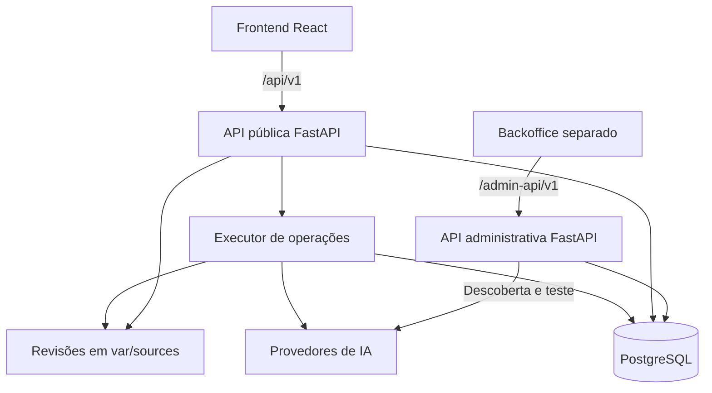

# Virou Case AI

Plataforma para aprender a construir aplicações com inteligência artificial: entender um conceito, preparar uma solicitação, criar um projeto, acompanhar as alterações no código e revisar o resultado em uma IDE no navegador.

A experiência reúne **Meus projetos**, **Aprender**, acompanhamento de consumo e administração de acessos e integrações de IA. O usuário descreve o resultado desejado; a plataforma usa o contexto do projeto e da conversa para implementar alterações ou pedir um esclarecimento quando necessário.

Este README documenta o backend, o frontend e os contratos administrativos presentes no código, incluindo a formatação inicial da IDE e a aplicação automática das alterações conversacionais. A interface do backoffice é um componente separado; seu código não está nos pacotes usados para esta documentação.

## Navegação

- [Objetivo](#objetivo)
- [Arquitetura](#arquitetura)
- [Telas e jornadas](#telas-e-jornadas)
- [Como rodar com Docker](#como-rodar-com-docker)
- [Desenvolvimento local](#desenvolvimento-local)
- [Configuração da IA e primeiro acesso](#configuração-da-ia-e-primeiro-acesso)
- [Testes e verificações](#testes-e-verificações)
- [Operação e diagnóstico](#operação-e-diagnóstico)
- [Limites atuais](#limites-atuais)

## Objetivo

O Virou Case AI apoia quem está aprendendo a transformar uma ideia em uma aplicação, com orientação, código acessível e histórico das mudanças. O ciclo principal é:

1. **Aprender:** consultar guias, exemplos e templates sobre contexto, requisitos, implementação, revisão e segurança.
2. **Preparar:** adaptar um template ao objetivo do projeto e transferir a solicitação para a conversa.
3. **Construir:** solicitar uma implementação, acompanhar o progresso e receber o código alterado com uma explicação.
4. **Revisar:** inspecionar arquivos, editar, visualizar a interface e consultar ou restaurar revisões.
5. **Exportar:** baixar o código-fonte para continuar o desenvolvimento em um ambiente próprio.

O acesso dos alunos é provisionado administrativamente. O contato pela página de experimentação não cria uma conta, não concede créditos e não processa pagamentos automaticamente. A oferta e os prazos são consultados na API; a ativação e a renovação são manuais.

**Estado atual da publicação:** a prévia visual está disponível para arquivos estáticos. A execução do backend dos projetos e a publicação hospedada permanecem bloqueadas por `CAPABILITY_UNVALIDATED`. A tela de publicação informa essa restrição.

## Arquitetura

### Componentes e comunicação



O backend compartilha regras de negócio e persistência entre a API pública, a API administrativa e o worker. São processos separados do mesmo projeto Python. A conversa pode iniciar a execução em uma tarefa da própria API após aceitar a solicitação; o worker também processa os jobs persistidos e trata recuperação, exportação e ciclo de vida.

As operações e os jobs ficam no PostgreSQL. A interface acompanha o progresso por consultas HTTP periódicas: aproximadamente a cada 1,5 segundo durante operações ativas e 4 segundos sem atividade, com aumento do intervalo após falhas. O fluxo atual não transmite tokens por WebSocket ou SSE.

| Componente             | Tecnologia no projeto                     | Responsabilidade                                                                                        |
| ---------------------- | ----------------------------------------- | ------------------------------------------------------------------------------------------------------- |
| Frontend               | React 19, TypeScript, React Router e Vite | Navegação, sessão, projetos, aprendizado, consumo e comunicação com a API.                              |
| IDE                    | CodeMirror 6 e Prettier em Web Worker     | Edição, destaque de sintaxe e formatação sem bloquear a interface.                                      |
| Prévia visual          | HTML, CSS e JavaScript em iframe isolado  | Exibir arquivos de `public/`, sem executar o servidor ou o banco do projeto.                            |
| Backend                | Python 3.12+, FastAPI e Pydantic          | Contratos HTTP, autorização e coordenação dos casos de uso.                                             |
| Persistência           | PostgreSQL 17, SQLAlchemy e Alembic       | Contas, sessões, acessos, projetos, rascunhos, operações, consumo e auditoria.                          |
| Arquivos dos projetos  | Armazenamento local em `var/sources`      | Revisões imutáveis em JSON, identificadas por conta, projeto e revisão, com verificação de integridade. |
| Integrações de IA      | Adaptadores HTTP para OpenAI e Gemini     | Requisições estruturadas, uso de tokens, validação da resposta e tratamento de falhas.                  |
| Execução em containers | Docker Compose e Nginx                    | Inicialização, isolamento dos serviços, proxy da API e entrega do frontend compilado.                   |

As versões exatas das dependências estão em [backend/requirements.lock](backend/requirements.lock), [backend/pyproject.toml](backend/pyproject.toml), [frontend/package.json](frontend/package.json) e [frontend/package-lock.json](frontend/package-lock.json).

### Organização do código

Este documento usa `backend/` e `frontend/` como nomes das pastas dos dois projetos. Coloque o README na raiz que as reúne. Se os repositórios estiverem separados ou tiverem outros nomes, ajuste os caminhos dos comandos e links.

| Caminho                                                                    | Conteúdo                                                                       |
| -------------------------------------------------------------------------- | ------------------------------------------------------------------------------ |
| [backend/src/viracase/domain](backend/src/viracase/domain)                 | Regras de acesso, limites, consumo, seleção da stack e validação dos arquivos. |
| [backend/src/viracase/application](backend/src/viracase/application)       | Casos de uso de geração, contratos de resposta e mensagens de progresso.       |
| [backend/src/viracase/infrastructure](backend/src/viracase/infrastructure) | Banco, repositórios, worker, provedores, credenciais, fontes e rascunhos.      |
| [backend/src/viracase/interfaces](backend/src/viracase/interfaces)         | APIs pública e administrativa e schemas de entrada.                            |
| [backend/migrations](backend/migrations)                                   | Migrations Alembic; o pacote atual chega à revisão `0003`.                     |
| [backend/content](backend/content)                                         | Guias e templates do módulo Aprender, em JSON.                                 |
| [backend/config](backend/config)                                           | Catálogo de modelos por arquivo, utilizado quando aplicável.                   |
| [backend/script](backend/script)                                           | Inicialização, administração, verificação e testes integrados.                 |
| [frontend/src/app](frontend/src/app)                                       | Sessão, estrutura autenticada e navegação.                                     |
| [frontend/src/features](frontend/src/features)                             | Telas e componentes de projetos, IDE, conversa, aprendizado e consumo.         |
| [frontend/src/preview](frontend/src/preview)                               | Runtime da prévia isolada.                                                     |
| [frontend/src/shared](frontend/src/shared)                                 | Cliente HTTP, tipos, componentes compartilhados e estilos.                     |
| [frontend/tests](frontend/tests) e [backend/tests](backend/tests)          | Testes de domínio, contratos, integração e navegador.                          |

### Plataforma e projetos gerados

A plataforma usa PostgreSQL. Os projetos criados pelos alunos seguem o catálogo de templates **Hono + TypeScript + D1** ou **FastAPI + Python + D1**, com interface estática em `public/`. D1 pertence ao projeto gerado; não substitui o banco da plataforma.

A stack é selecionada a partir do objetivo do projeto. O template prepara arquivos, configuração e migration inicial. Criar ou exportar um projeto não provisiona uma conta Cloudflare, não cria um banco D1 real e não publica a aplicação.

### Fluxo da construção conversacional

1. O frontend salva as edições manuais pendentes antes de enviar o pedido ao endpoint `POST /api/v1/projects/{pid}/conversation`.
2. O backend verifica sessão, acesso, revisão de origem, política de IA e saldo. A operação recebe uma chave de idempotência e uma reserva de consumo.
3. A geração recebe o objetivo, os arquivos atuais e o histórico recente da conversa do mesmo projeto. O resultado pode ser uma implementação ou uma pergunta de esclarecimento.
4. O backend valida o formato, os caminhos, os limites e a estrutura dos arquivos. Respostas inválidas podem passar por correção limitada; conteúdo parcial não é gravado como revisão válida.
5. Quando a implementação é concluída e a base permanece compatível, uma nova revisão é aplicada automaticamente. O frontend sincroniza os arquivos e mostra a explicação e a lista de alterações.
6. Se outra sessão alterou a revisão ou deixou um rascunho incompatível, o resultado fica como proposta para revisão, sem sobrescrever esse trabalho.

Uma pergunta de esclarecimento aparece na conversa e pode receber uma resposta curta, mantendo o contexto. Ela não cria uma revisão de código. Como envolve uma chamada ao provedor, pode consumir saldo.

O progresso informa as etapas e os arquivos envolvidos, sem expor o nome do agente ou do modelo ao aluno. A validação estrutural não equivale à execução de testes da aplicação gerada. Em falhas com consumo desconhecido, a operação pode aguardar reconciliação em vez de repetir uma chamada potencialmente cobrada.

### Segurança e persistência

- Sessões de aluno e administrador usam cookies distintos, `HttpOnly` e `SameSite=Strict`; a aplicação valida origem e token CSRF nas operações protegidas.
- Mutações usam os mecanismos de idempotência e versão definidos pelos respectivos endpoints. Projetos, revisões e operações são autorizados por conta.
- Credenciais de IA administradas são criptografadas no banco. A chave local é mantida em `var/secrets/credentials.key` e compartilhada com os processos que precisam ler as credenciais.
- A prévia usa iframe com origem isolada e uma política de conteúdo própria. Ela não recebe os cookies da plataforma nem acessa suas APIs autenticadas.
- Contas, histórico financeiro e metadados ficam no PostgreSQL; o conteúdo das revisões fica em `var/sources`. Um backup recuperável precisa contemplar ambos e a chave das credenciais.

## Telas e jornadas

As rotas abaixo pertencem ao frontend público. `:projectId` e `:slug` representam identificadores da URL.

| Tela                 | Rota                                 | O que o usuário faz                                                                                                  |
| -------------------- | ------------------------------------ | -------------------------------------------------------------------------------------------------------------------- |
| Início               | `/`                                  | Conhece a proposta, acessa a experimentação ou entra na plataforma.                                                  |
| Experimentação       | `/experimentacao`                    | Consulta a oferta da API e inicia contato para verificar disponibilidade.                                            |
| Login                | `/login`                             | Entra com as credenciais de aluno fornecidas pelo responsável pelo acesso.                                           |
| Meus projetos        | `/app/projetos`                      | Lista projetos, consulta a cota e cria um projeto informando nome e objetivo.                                        |
| Ambiente do projeto  | `/app/projetos/:projectId`           | Conversa com a IA, acompanha progresso, navega nos arquivos, edita código, salva revisões, abre a prévia e exporta.  |
| Histórico            | `/app/projetos/:projectId/historico` | Inspeciona revisões e restaura uma versão criando outra revisão, preservando o histórico.                            |
| Publicação           | `/app/projetos/:projectId/publicar`  | Consulta o estado da capacidade de publicação e retorna à prévia do projeto. A publicação está bloqueada atualmente. |
| Aprender             | `/app/aprendizado`                   | Pesquisa e filtra guias, skills e templates.                                                                         |
| Aplicação de um guia | `/app/aprendizado/:slug`             | Entende o conceito, preenche os campos, revisa o prompt e o transfere para um projeto.                               |
| Uso e acesso         | `/app/consumo`                       | Consulta consumo, reservas, saldo relativo, período de acesso e retenção.                                            |
| Conta                | `/app/conta`                         | Confere nome, login e situação de acesso e encontra o contato de suporte.                                            |

`/app` redireciona para Meus projetos. As telas da área autenticada exigem sessão de aluno; uma sessão administrativa não substitui esse acesso.

### IDE e prévia

A IDE reúne a conversa, os arquivos e a visualização do código. Arquivos suportados já são apresentados formatados ao abrir. A formatação inicial é de apresentação: somente abrir um arquivo não cria uma revisão nem grava alterações no projeto. O botão de formatação continua disponível durante a edição.

O formatador contempla HTML, CSS, SCSS, Less, JavaScript, TypeScript, JSX/TSX, JSON/JSONC e Markdown. Python e SQL têm destaque de sintaxe, mas não recebem a mesma formatação automática. Se a formatação falhar, o conteúdo original permanece disponível com um aviso.

A prévia usa `public/index.html` como entrada e carrega os recursos públicos locais. Oferece largura completa ou de celular e o comando **Atualizar prévia** quando o código muda. Chamadas à API do projeto, dependências externas, servidor Python/Node e consultas ao D1 não são executados nesse ambiente; um aviso de conexão do template inicial pode ser consequência dessa limitação.

### Do aprendizado ao projeto

O módulo Aprender organiza a jornada em entender, adaptar e aplicar. O usuário personaliza um template, revisa o texto e escolhe o projeto de destino. Se já houver texto na conversa, pode acrescentar ou substituir mediante a interação de confirmação. A transferência prepara a solicitação; não dispara geração nem altera os arquivos por conta própria.

### Administração e agentes de IA

A API administrativa usa o prefixo `/admin-api/v1` e oferece os seguintes recursos ao backoffice:

| Área administrativa | Recursos implementados na API                                                                                       |
| ------------------- | ------------------------------------------------------------------------------------------------------------------- |
| Contas e acesso     | Cadastro de alunos, redefinição de credenciais, concessão de acesso, suspensão e ajustes de prazo.                  |
| Consumo             | Recargas, ajustes de carteira, consulta de saldo e reconciliação de operações.                                      |
| Operação            | Consulta de operações, eventos de auditoria e estado operacional.                                                   |
| Integrações de IA   | Cadastro e edição de conexões, catálogo e descoberta de modelos, política de custo, habilitação e teste de geração. |

Os nomes e as rotas das telas do backoffice dependem de seu frontend separado e não são definidos neste repositório. As implementações verificáveis estão em [api.py](backend/src/viracase/interfaces/api.py), [ai_routes.py](backend/src/viracase/interfaces/ai_routes.py) e [ai_schemas.py](backend/src/viracase/interfaces/ai_schemas.py).

## Como rodar com Docker

### Requisitos

- Docker Engine ou Docker Desktop em execução e Docker Compose v2 com suporte a `--wait`.
- Bash para executar os scripts; no Windows, use um ambiente compatível, como WSL.
- Acesso à rede para baixar imagens e dependências; as gerações reais também precisam alcançar o provedor configurado.
- Portas locais livres: `5173`, `8000`, `8001` e `55432`, na configuração padrão. A interface do backoffice usa sua própria porta.

Nesse modo, Python e Node são usados dentro das imagens. Não é necessário instalá-los no host apenas para subir os containers.

### 1. Preparar o backend

Na raiz que contém os dois projetos:

```bash
cd backend
if [ ! -f .env ]; then
  cp .env.example .env
  chmod 600 .env
fi
```

Edite `.env` antes da primeira inicialização. Preserve a configuração de uma instalação existente. Substitua as credenciais de exemplo por valores próprios; não use a senha administrativa que acompanha o exemplo como senha de uma instalação real.

| Variável                                       | Como configurar                                                                                                                         |
| ---------------------------------------------- | --------------------------------------------------------------------------------------------------------------------------------------- |
| `POSTGRES_PASSWORD`                            | Senha do usuário administrativo do PostgreSQL, usado na inicialização e nas migrations.                                                 |
| `APP_DB_PASSWORD`                              | Senha do usuário `viracase`, utilizado pela aplicação.                                                                                  |
| `POSTGRES_DB` / `POSTGRES_PORT`                | Nome do banco e porta publicada no host; padrões `viracase` e `55432`.                                                                  |
| `VIRA_ADMIN_LOGIN` / `VIRA_ADMIN_NAME`         | Login e nome do administrador inicial.                                                                                                  |
| `VIRA_ADMIN_PASSWORD`                          | Senha administrativa própria, entre 12 e 128 caracteres. A inicialização também sincroniza essa senha para o administrador configurado. |
| `VIRA_PUBLIC_ORIGIN`                           | Origens exatas do frontend. Para o padrão local: `http://127.0.0.1:5173,http://localhost:5173`.                                         |
| `VIRA_ADMIN_ORIGIN`                            | Origens exatas da interface administrativa; precisam usar loopback e coincidir com a porta do backoffice.                               |
| `VIRA_PUBLIC_HOSTS`                            | Hosts aceitos pela API pública; localmente, `127.0.0.1,localhost`.                                                                      |
| `VIRA_COOKIE_SECURE`                           | `false` apenas no HTTP local. A configuração exige `true` para origens públicas não locais.                                             |
| `VIRA_SOURCE_ROOT`                             | Diretório persistente das fontes, normalmente `var/sources`.                                                                            |
| `VIRA_CONTENT_ROOT` / `VIRA_CATALOG_PATH`      | Guias e catálogo por arquivo, normalmente `content` e `config/models.json`.                                                             |
| `VIRA_PROVIDER_TIMEOUT`                        | Tempo limite da chamada ao provedor, em segundos; padrão `180`.                                                                         |
| `VIRA_LIFECYCLE_ENABLED` / `VIRA_RESTORE_HOLD` | Controle do ciclo de vida e bloqueio operacional para recuperação; padrões `true` e `false`.                                            |

**Porta administrativa:** o `.env.example` deste pacote usa `5175`; os valores padrão de `config.py` e `compose.yaml` usam `5174`. A configuração explícita do `.env` prevalece no Compose. Ajuste-a à URL real do seu backoffice antes de tentar login. O backend valida a origem completa, incluindo esquema, host e porta.

O Compose constrói a conexão com o banco a partir de `POSTGRES_DB`, `APP_DB_PASSWORD` e do host interno `postgres`. `VIRA_DATABASE_URL` e `VIRA_MIGRATION_DATABASE_URL` são relevantes para a execução nativa descrita adiante.

### 2. Iniciar os serviços do backend

Ainda em `backend/`:

```bash
bash script/run-docker.sh
```

O script verifica o Docker e a configuração, prepara os diretórios, executa `docker compose up -d --build --wait --wait-timeout 300` e confere as credenciais administrativas. Os serviços do Compose são:

| Serviço        | Função                                                                                    |
| -------------- | ----------------------------------------------------------------------------------------- |
| `postgres`     | Banco persistente, com healthcheck.                                                       |
| `storage-init` | Prepara diretórios e permissões para o usuário de execução.                               |
| `initialize`   | Confere migrations, atualiza o schema, aplica permissões e prepara chave e administrador. |
| `public-api`   | API de alunos em `127.0.0.1:8000`.                                                        |
| `admin-api`    | API administrativa em `127.0.0.1:8001`.                                                   |
| `worker`       | Processa operações persistidas e tarefas do ciclo de vida.                                |

`storage-init` e `initialize` são inicializadores: terminar com código zero é o comportamento esperado. O script não apaga o volume do banco. A inicialização com uma senha administrativa diferente pode encerrar sessões administrativas ao sincronizá-la.

### 3. Iniciar o frontend

Em outro terminal, a partir da raiz geral:

```bash
cd frontend
bash script/run-docker.sh
```

O backend precisa estar iniciado para criar a rede `viroucaseai-public`. O frontend usa essa rede para o proxy da API. Seu script compila a aplicação, sobe o Nginx e espera o healthcheck.

Abra [http://127.0.0.1:5173](http://127.0.0.1:5173) ou [http://localhost:5173](http://localhost:5173). Use o mesmo host ao longo da sessão, pois `localhost` e `127.0.0.1` têm cookies separados.

| Serviço local                   | Endereço padrão                                                          |
| ------------------------------- | ------------------------------------------------------------------------ |
| Plataforma                      | [http://127.0.0.1:5173](http://127.0.0.1:5173)                           |
| Prontidão via proxy do frontend | [http://127.0.0.1:5173/health/ready](http://127.0.0.1:5173/health/ready) |
| Prontidão da API pública        | [http://127.0.0.1:8000/health/ready](http://127.0.0.1:8000/health/ready) |
| Prontidão da API administrativa | [http://127.0.0.1:8001/health/ready](http://127.0.0.1:8001/health/ready) |
| PostgreSQL                      | `127.0.0.1:55432`                                                        |

A porta `8001` serve a API administrativa, não a interface do backoffice. Instale e inicie essa interface a partir de seu próprio projeto, apontando o proxy administrativo para a API e alinhando `VIRA_ADMIN_ORIGIN`. Os serviços locais do Compose são publicados em loopback; esse procedimento não configura uma implantação pública com domínio e TLS.

### 4. Conferir e atualizar

Em `backend/`:

```bash
docker compose ps
docker compose logs --tail=100 initialize storage-init public-api admin-api worker
curl --fail http://127.0.0.1:8000/health/ready
```

Após aplicar uma atualização de código ou Compose, execute novamente `bash script/run-docker.sh` no backend e depois no frontend. Os scripts já usam `--build`, sobem os serviços e aguardam a prontidão. Não é necessário apagar o banco para atualizar containers. `docker compose restart`, isoladamente, não executa o build previsto nesses scripts.

`bash script/run-local.sh` também inicia Docker por padrão. O modo nativo exige `--native`.

## Desenvolvimento local

Esse modo executa as APIs e o worker no host, mantendo o PostgreSQL em Docker. Requer Python 3.12+, suporte a `venv`, Docker/Compose, Node.js 22.12+ ou 24 e npm. A imagem de build do frontend usa Node.js 24.

Prepare `backend/.env` como descrito acima e confira as conexões nativas:

- `VIRA_DATABASE_URL`: URL SQLAlchemy `postgresql+psycopg` do usuário `viracase`, com a senha de `APP_DB_PASSWORD`, host `127.0.0.1`, porta publicada e banco configurados.
- `VIRA_MIGRATION_DATABASE_URL`: conexão do usuário administrativo `postgres`, com a senha de `POSTGRES_PASSWORD`, para o mesmo banco.
- As senhas nas URLs precisam corresponder às do PostgreSQL; caracteres reservados de URL precisam de codificação apropriada.

Em uma instalação nova, `script/bootstrap-env.py` pode criar `.env` com senhas aleatórias para o banco quando o arquivo não existe. Isso não substitui a revisão das credenciais administrativas e das origens. Com `.env` existente, o script o preserva.

No terminal do backend:

```bash
cd backend
bash script/run-local.sh --native
```

No terminal do frontend:

```bash
cd frontend
bash script/run-local.sh --native
```

O script do backend instala as dependências, aplica migrations, prepara as credenciais e inicia as duas APIs e o worker. O do frontend executa `npm ci`, confere os tipos e inicia o Vite em `5173`, com proxy `/api` para `8000`. `Ctrl+C` encerra os processos nativos iniciados pelo respectivo script; o PostgreSQL continua em Docker.

Evite executar as mesmas APIs e o mesmo frontend simultaneamente nos modos Docker e nativo, pois as portas são compartilhadas. Os scripts nativos usam as portas `8000`, `8001` e `5173` diretamente; os overrides de portas do Compose não alteram esses comandos.

## Configuração da IA e primeiro acesso

Ter os containers saudáveis não habilita a geração automaticamente. A configuração precisa incluir um provedor utilizável e uma política de consumo válida.

### Integrações administradas

O backend permite gerenciar conexões e modelos pelo backoffice, por meio das rotas `/admin-api/v1/ai/connections`:

1. Cadastre a conexão e a credencial adequada. OpenAI usa uma chave; no modo de conta de serviço, informe também seu projeto. Gemini aceita chave de API ou JSON de conta de serviço Google, com projeto e localização para Vertex AI.
2. Consulte o catálogo ou faça a descoberta de modelos. Um modelo listado ainda não está necessariamente pronto para geração.
3. Cadastre a política: preços de entrada, cache e saída, câmbio BRL/USD, fonte do câmbio, evidência, período de validade e limite de tokens de saída.
4. Execute o teste explícito do modelo, confira o resultado e mantenha conexão e modelo habilitados. Esse teste chama o provedor real e pode gerar custo.
5. Confirme que o modelo aparece como pronto e que a conta do aluno possui acesso ativo e saldo suficiente.

Alterações na conexão podem exigir nova verificação do modelo. O catálogo por arquivo em `backend/config/models.json` permanece disponível para provedores sem gestão assumida pelo cadastro administrativo; ele depende também de `VIRA_OPENAI_API_KEY` ou `VIRA_GEMINI_API_KEY`. Os registros fornecidos no arquivo estão desabilitados e não constituem uma configuração comercial pronta. Cadastrar apenas uma chave no `.env` não basta.

Preserve `backend/var/secrets/credentials.key`: a API pública, a API administrativa e o worker precisam ler a mesma chave para usar credenciais criptografadas. Não a substitua ao atualizar a aplicação.

### Entrar como aluno

1. O administrador cria a conta de aluno e concede o acesso e o orçamento aplicáveis pela administração.
2. O aluno abre `/login` e usa as credenciais recebidas.
3. Em Meus projetos, cria um projeto com nome e objetivo.
4. Abre a IDE, envia uma solicitação e acompanha a resposta. Se a IA pedir esclarecimento, usa **Responder** para manter a referência à pergunta.
5. Confere os arquivos alterados, atualiza a prévia quando necessário e utiliza o histórico ou a exportação para revisar e continuar o trabalho.

O login administrativo não funciona como login de aluno. A aplicação não oferece cadastro público automático.

## Testes e verificações

Execute os testes em ambiente de desenvolvimento. Os comandos abaixo usam a estrutura `backend/` e `frontend/`; cada bloco indica seu diretório.

### Backend — em `backend/`

```bash
python3 -m venv .venv
.venv/bin/python -m pip install -r requirements.lock
.venv/bin/python -m pip install -e '.[test]'
.venv/bin/python -m pytest -q
.venv/bin/python -m ruff check src tests --select F,E9
.venv/bin/python script/check-migrations.py
```

A suíte usa bancos temporários SQLite quando `TEST_DATABASE_URL` não está definido. Os cenários específicos de concorrência PostgreSQL exigem essa variável apontando para um banco de testes, com permissão para criar schemas. O teste de imagem real exige Docker e `VIRA_TEST_DOCKER=1`. Testes ignorados por ausência desses requisitos não validam essas integrações.

### Frontend — em `frontend/`

```bash
npm ci
npm run check
npm run build
```

### IDE, conversa e prévia em navegador

Instale o navegador de teste em `frontend/`:

```bash
npx playwright install chromium
```

Com as dependências dos dois projetos instaladas e as portas `8000` e `5173` livres, execute em `backend/`:

```bash
.venv/bin/python script/test-workspace.py --frontend ../frontend
```

Esse runner cria um laboratório isolado, compila o frontend, inicia os serviços de teste e executa `workspace.spec.ts` e `preview.spec.ts`. Usa respostas simuladas de IA; não atesta credenciais reais ou disponibilidade dos provedores. Caso o sistema ainda precise de dependências do Chromium, prepare-as antes da execução. É possível indicar um Chromium já instalado pela variável `PLAYWRIGHT_CHROMIUM_EXECUTABLE`.

O runner `script/test-e2e.py` exige também o projeto irmão `backoffice/` e suas dependências, usando as portas `8000`, `8001`, `5173`, `5174` e `5175`. Não está completo apenas com backend e frontend. Da mesma forma, `script/verify-docker.py` espera containers dos três projetos e a interface administrativa na porta `5174`; ajuste o ambiente antes de utilizá-lo se o backoffice estiver em outra porta.

As APIs desabilitam `/docs`, `/redoc` e a publicação de OpenAPI. Para consultar os contratos, use os schemas, as rotas e os testes do código.

## Operação e diagnóstico

### Preservação de dados

Mantenha o volume `postgres-data`, o diretório de fontes configurado em `VIRA_SOURCE_ROOT` e `var/secrets/credentials.key` entre atualizações. A chave e o banco precisam corresponder para que as credenciais de IA possam ser recuperadas. Preserve também a configuração do ambiente, sem incluí-la em commits ou pacotes de código.

Para parar sem remover os volumes, use `docker compose stop` no diretório do frontend e no do backend. Não use `docker compose down -v` como procedimento de atualização: ele remove volumes gerenciados pelo Compose, incluindo o banco.

Alterar as senhas do PostgreSQL apenas no `.env` de um banco já inicializado não atualiza as senhas gravadas nele. Faça mudanças de credenciais de forma coordenada com o banco existente. A sincronização automática de `VIRA_ADMIN_PASSWORD` trata a conta administrativa da aplicação, não os usuários PostgreSQL.

O worker aplica a política de ciclo de vida quando `VIRA_LIFECYCLE_ENABLED=true`. O período padrão é de 30 dias de acesso, seguido de dois dias de retenção, sujeito aos ajustes administrativos. Não use a instalação como armazenamento permanente fora do prazo de acesso e retenção configurado.

### Problemas frequentes

| Sintoma                                                                    | O que conferir                                                                                                                                                                                                                                                                                |
| -------------------------------------------------------------------------- | --------------------------------------------------------------------------------------------------------------------------------------------------------------------------------------------------------------------------------------------------------------------------------------------- |
| O primeiro script para após criar `.env`                                   | Preencha as configurações solicitadas e execute novamente. Essa interrupção é prevista quando o arquivo não existia.                                                                                                                                                                          |
| Frontend informa que a rede não existe                                     | Inicie primeiro o backend, que cria `viroucaseai-public`.                                                                                                                                                                                                                                     |
| `502` no frontend ou falha em `/health/ready`                              | Confira os containers `public-api`, `postgres` e os logs de `initialize`; a prontidão verifica a revisão de migrations esperada.                                                                                                                                                              |
| `ORIGIN_DENIED` no login                                                   | Compare a URL do navegador com `VIRA_PUBLIC_ORIGIN` ou `VIRA_ADMIN_ORIGIN`, incluindo porta e esquema. No backoffice, confira a diferença entre `5174` e `5175`.                                                                                                                              |
| Credenciais administrativas não entram na plataforma                       | Use o backoffice para o administrador e `/login` para uma conta de aluno. Confira também se as credenciais administrativas do `.env` correspondem à instalação.                                                                                                                               |
| `COMMERCIAL_CONFIGURATION_PENDING`                                         | Verifique conexão, credencial, teste do modelo, habilitação e política de preços/câmbio dentro da validade. Confira também `VIRA_RESTORE_HOLD`.                                                                                                                                               |
| `generation_provider_rejected` / `PROVIDER_CONFIGURATION_INVALID`          | Correlacione o `operation_id` e confira `reason_code`, `http_status` ou `unsupported_field`, quando presentes. Examine conexão, política e leitura da chave por API pública e worker. Logs antigos podem registrar apenas a categoria `configuration`, insuficiente para identificar a causa. |
| `GENERATION_TRUNCATED`, `INVALID_GENERATION` ou `GENERATION_EDIT_MISMATCH` | Correlacione a operação com os logs da API pública e do worker. Confira limite de saída, contrato e eventos `generation_response_invalid`; o tamanho da solicitação, sozinho, não determina o tamanho ou a validade da resposta.                                                              |
| A resposta virou uma proposta em vez de ser aplicada                       | Verifique alterações concorrentes na revisão ou no rascunho. Revise a proposta antes de aplicar sobre a versão atual.                                                                                                                                                                         |
| Operação em reconciliação                                                  | Confirme o resultado e o consumo pelo fluxo administrativo antes de emitir outra geração. Uma falha de comunicação pode deixar o consumo desconhecido.                                                                                                                                        |
| A prévia não acessa `/api/health` do projeto                               | A prévia executa somente recursos públicos estáticos; não inicia a API gerada nem o D1.                                                                                                                                                                                                       |
| Código recente não aparece na prévia                                       | Use **Atualizar prévia** e confira os avisos de arquivos e navegação.                                                                                                                                                                                                                         |

Para correlacionar falhas de geração, consulte ambos os processos: a execução pode ter começado na API pública ou no worker. O `200 OK` ao salvar um rascunho confirma apenas essa gravação; ele não confirma o sucesso da chamada de IA.

## Limites atuais

| Recurso                    | Limite ou comportamento                                                                                                                                                                       |
| -------------------------- | --------------------------------------------------------------------------------------------------------------------------------------------------------------------------------------------- |
| Projetos por conta         | Até 2.                                                                                                                                                                                        |
| Arquivos por projeto       | Até 80; conteúdo textual.                                                                                                                                                                     |
| Tamanho por arquivo        | Até 200.000 bytes.                                                                                                                                                                            |
| Tamanho total do projeto   | Até 2.000.000 bytes.                                                                                                                                                                          |
| Caminho de arquivo         | Até 180 caracteres, sujeito à validação de caminhos permitidos.                                                                                                                               |
| Solicitação conversacional | De 1 a 12.000 caracteres; o contexto total também precisa caber no orçamento da operação.                                                                                                     |
| Revisões por projeto       | Até 100.                                                                                                                                                                                      |
| Geração conversacional     | Até 4 lotes/tentativas no executor; correções de resposta compartilham esse limite. O adaptador pode repetir uma requisição explicitamente rejeitada por incompatibilidade de campo opcional. |
| Formatação inicial         | Disponível para as linguagens listadas na seção IDE; abrir o arquivo não grava uma revisão.                                                                                                   |
| Prévia                     | HTML, CSS e JavaScript públicos, sem backend, banco ou acesso de rede externo.                                                                                                                |
| Publicação hospedada       | Bloqueada no estado atual da plataforma.                                                                                                                                                      |

Os limites e capacidades expostos ao frontend estão em `GET /api/v1/capabilities`; a autorização final é sempre aplicada no backend. Para continuar o desenvolvimento de um projeto fora desses recursos, exporte a revisão e siga o README do próprio projeto em um ambiente separado.
